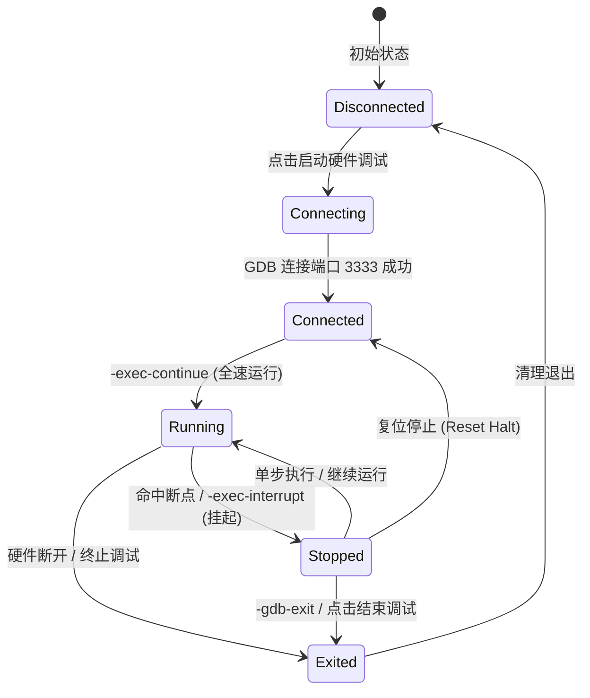

# 📘 STM32 嵌入式编译构建、固件烧录与硬件 GDB 调试系统
## —— 架构设计指导与工业级开发参考手册 (Design Guide & Reference Manual)

---

## 目录 (Table of Contents)
- [第一篇：体系总览与设计理念](#第一篇体系总览与设计理念)
  - [1.1 传统嵌入式开发痛点与重构动因](#11-传统嵌入式开发痛点与重构动因)
  - [1.2 从单体耦合向微核与独立套件演进](#12-从单体耦合向微核与独立套件演进)
  - [1.3 整体系统分层架构](#13-整体系统分层架构)
- [第二篇：GNU Arm 交叉编译与自动化构建深度解析](#第二篇gnu-arm-交叉编译与自动化构建深度解析)
  - [2.1 GNU Arm 交叉工具链核心组件职责](#21-gnu-arm-交叉工具链核心组件职责)
  - [2.2 STM32 启动机制与链接脚本 (.ld) 深度解剖](#22-stm32-启动机制与链接脚本-ld-深度解剖)
  - [2.3 现代化依赖追踪 Makefile 自动生成器原理](#23-现代化依赖追踪-makefile-自动生成器原理)
  - [2.4 编译诊断流式解析与内存资源测算模型](#24-编译诊断流式解析与内存资源测算模型)
- [第三篇：多硬件适配的固件烧录与下载引擎](#第三篇多硬件适配的固件烧录与下载引擎)
  - [3.1 SWD / JTAG 调试接口与烧录原理](#31-swd--jtag-调试接口与烧录原理)
  - [3.2 OpenOCD 自动化烧录调度机制](#32-openocd-自动化烧录调度机制)
  - [3.3 SEGGER J-Link 动态脚本流烧录引擎](#33-segger-j-link-动态脚本流烧录引擎)
  - [3.4 烧录选项：擦除、基址、校验与自动复位运行](#34-烧录选项擦除基址校验与自动复位运行)
- [第四篇：基于 GDB/MI 协议的在线硬件调试引擎](#第四篇基于-gdbmi-协议的在线硬件调试引擎)
  - [4.1 调试网络拓扑与 GDB Server 守护机制](#41-调试网络拓扑与-gdb-server-守护机制)
  - [4.2 GDB/MI (Machine Interface v2) 协议规范与异步非阻塞调度](#42-gdbmi-machine-interface-v2-协议规范与异步非阻塞调度)
  - [4.3 调试状态机模型与生命周期流转](#43-调试状态机模型与生命周期流转)
  - [4.4 断点管理、调用栈回溯、变量监视与核心寄存器观测](#44-断点管理调用栈回溯变量监视与核心寄存器观测)
- [第五篇：模块独立与双运行形态实现细节](#第五篇模块独立与双运行形态实现细节)
  - [5.1 核心类设计与职责关系图](#51-核心类设计与职责关系图)
  - [5.2 独立应用程序形态 (Standalone Mode)](#52-独立应用程序形态-standalone-mode)
  - [5.3 Qt 原生动态扩展插件形态 (IAppPlugin Mode)](#53-qt-原生动态扩展插件形态-iappplugin-mode)
- [第六篇：端到端实战演练与测试指南](#第六篇端到端实战演练与测试指南)
  - [6.1 工具链一键自检与环境配置](#6.1-工具链一键自检与环境配置)
  - [6.2 标准工程骨架搭建 (STM32F103 点灯验证)](#62-标准工程骨架搭建-stm32f103-点灯验证)
  - [6.3 一键构建、错误诊断与内存占用实测](#63-一键构建错误诊断与内存占用实测)
  - [6.4 GDB 在线断点单步调试全流程演练](#64-gdb-在线断点单步调试全流程演练)
- [第七篇：工业级排错手册与常见陷阱 (Troubleshooting FAQ)](#第七篇工业级排错手册与常见陷阱-troubleshooting-faq)

---

## 第一篇：体系总览与设计理念

### 1.1 传统嵌入式开发痛点与重构动因
在传统嵌入式开发场景下，工程师常常面临工具链断裂带来的割裂体验：
1. **工具链绑定与商业授权锁定**：严重依赖 Keil MDK 或 IAR 等闭源商用环境，工程配置复杂，不利于 CI/CD 自动化；
2. **多工具频繁切换**：编译需切命令行，烧录需使用 ST-Link Utility / J-Flash，调试需开独立软件，串口看日志又需打开串口助手；
3. **原有单体代码的高耦合**：先前的 IDE 构建实现常直接侵入在主窗体代码中，写死编译器路径与参数，缺乏硬件多系列抽象，不可复用、难以测试。

### 1.2 从单体耦合向微核与独立套件演进
为解决上述问题，本项目确立了**“核心引擎无界面化、功能组件高内聚化、交付形态双轨化”**的解耦原则：
- **核心逻辑层 (Core Engine)**：剥离全部 GUI 依赖，纯 C++/Qt 底层调度，覆盖环境探测、芯片模型、Makefile 生成、多核构建、烧录分发、GDB 状态机；
- **表现层 (UI Presentation)**：工业风深色控制台，将复杂的编译器日志与 GDB 状态转化为直观的调用栈树、变量表、寄存器表和内存仪表盘；
- **独立化运行**：既可作为独立应用程序 `STM32Workbench.exe` 独立双击运行分发，又可作为标准动态插件 `STM32WorkbenchPlugin.dll` 无缝嵌入到 SmileCodeIDE 的 App Hub 应用市场中。

### 1.3 整体系统分层架构
```
┌─────────────────────────────────────────────────────────────────────────────┐
│                           SmileCodeIDE / PhudonTools                        │
│               [应用中心 App Hub / 代码编辑器 CodeEditor / 串口 / CAN]        │
└──────────────────────────────────────┬──────────────────────────────────────┘
                                       │ 插件装载 (IAppPlugin) / 独立启动
┌──────────────────────────────────────▼──────────────────────────────────────┐
│                    STM32 独立嵌入式工作台 (STM32Workbench)                   │
├─────────────────────────────────────────────────────────────────────────────┤
│                          [1. 交互表现层 UI Layer]                             │
│  • STM32WorkbenchWidget : 一体化工作台总览，一键构建/烧录/调试多核控制      │
│  • GdbDebugPanel        : 硬件调试观测窗 (调用栈/局部变量/寄存器/断点/终端) │
│  • ToolchainConfigDialog: 跨平台工具链一键环境自检与路径配置                │
│  • FlashConfigDialog    : 多硬件烧录器 (OpenOCD/J-Link/ST-Link) 参数配置    │
├─────────────────────────────────────────────────────────────────────────────┤
│                          [2. 核心调度层 Core Engine]                         │
│  • ToolchainDetector    : ARM-GCC / GDB / Make / OpenOCD / J-Link 智能探测  │
│  • STM32ProfileManager  : Cortex-M0/M3/M4/M7 芯片档案与链接脚本自动生成工厂│
│  • MakefileGenerator    : 跨平台依赖追踪 Makefile 自动生成引擎 (-MMD -MP)   │
│  • BuildManager         : 异步多线程并行构建调度器与 GCC 错误行号跳转解析   │
│  • FlashProgrammer      : OpenOCD / J-Link Commander / ST-Link 多协议烧录   │
│  • GdbServerManager     : OpenOCD / J-Link GDB Server 守护进程与端口探活   │
│  • GdbMiEngine          : 基于 GDB/MI 协议的异步双工调试状态机引擎          │
├─────────────────────────────────────────────────────────────────────────────┤
│                          [3. 交付形态与宿主适配]                            │
│  • 独立运行模式 (Standalone) : 生成 STM32Workbench.exe，可完全脱离主工程运行 │
│  • 动态插件模式 (Plugin)     : 生成 STM32WorkbenchPlugin.dll，热插拔到 AppHub│
└─────────────────────────────────────────────────────────────────────────────┘
```

---

## 第二篇：GNU Arm 交叉编译与自动化构建深度解析

### 2.1 GNU Arm 交叉工具链核心组件职责
GNU Arm 嵌入式工具链（`arm-none-eabi-*`）是一套针对裸机（Bare-metal）ARM Cortex 架构的工业级编译器套件：
- **`arm-none-eabi-gcc` / `g++`**：C/C++ 交叉编译器，负责将源文件翻译为目标平台的汇编指令与机器码；
- **`arm-none-eabi-as`**：汇编器，处理如 `startup_stm32f103xb.s` 启动文件；
- **`arm-none-eabi-ld`**：链接器，根据链接脚本（`.ld`）将多个 `.o` 文件与运行时库（`libc_nano.a`, `libnosys.a`）重定向并拼接为包含绝对硬件内存地址的 `.elf` 文件；
- **`arm-none-eabi-objcopy`**：段提取转换器，将包含符号信息的大体积 ELF 文件提取转换为轻量的原始二进制文件（`.bin`）或十六进制文件（`.hex`），用于直接烧录至 MCU Flash；
- **`arm-none-eabi-size`**：段尺寸统计器，读取 ELF 文件头部，输出 `.text`、`.data`、`.bss` 各段的大小；
- **`arm-none-eabi-gdb`**：调试器客户端，通过远程串口/网口协议与 GDB Server 通信，支持单步、断点、寄存器读取与堆栈解析。

### 2.2 STM32 启动机制与链接脚本 (.ld) 深度解剖
Cortex-M 架构上电后的第一条指令并非从 `main()` 开始，而是经过固件引导：
1. **上电取栈顶**：硬件自动从地址 `0x08000000` 取出 4 字节数据加载到主堆栈指针 MSP（即 `_estack`）；
2. **取复位向量**：从 `0x08000004` 取出复位中断向量地址加载到程序计数器 PC，跳转至 `Reset_Handler`；
3. **搬移初始数据**：`Reset_Handler` 负责将位于 Flash 的初始化数据（`.data` 初始值）拷贝至 SRAM，并把 `.bss` 未初始化全局变量区域清零；
4. **跳转用户主函数**：执行 `bl main`。

#### 核心链接脚本原理 (`STM32F103C8Tx_FLASH.ld`)
```ld
ENTRY(Reset_Handler)

/* 堆栈基地址定义：SRAM 基地址 (0x20000000) + SRAM 大小 (20KB) = 0x20005000 */
_estack = 0x20000000 + 20K;

_Min_Heap_Size = 0x200;  /* 512B 最小堆 */
_Min_Stack_Size = 0x400; /* 1KB 最小栈 */

MEMORY
{
  RAM   (xrw) : ORIGIN = 0x20000000, LENGTH = 20K
  FLASH (rx)  : ORIGIN = 0x08000000, LENGTH = 64K
}

SECTIONS
{
  /* 中断向量表必须置于 Flash 起始 0x08000000 处 */
  .isr_vector :
  {
    . = ALIGN(4);
    KEEP(*(.isr_vector))
    . = ALIGN(4);
  } >FLASH

  /* 代码段与只读数据段 */
  .text : { ... } >FLASH
  .rodata : { ... } >FLASH

  /* .data 段：加载地址 (LMA) 在 Flash，运行地址 (VMA) 在 RAM */
  _sidata = LOADADDR(.data);
  .data :
  {
    . = ALIGN(4);
    _sdata = .;
    *(.data)
    *(.data*)
    _edata = .;
  } >RAM AT> FLASH

  /* .bss 段：置于 RAM，运行时必须清零 */
  .bss :
  {
    . = ALIGN(4);
    _sbss = .;
    *(.bss)
    *(.bss*)
    _ebss = .;
  } >RAM
}
```

### 2.3 现代化依赖追踪 Makefile 自动生成器原理
传统的初学者 Makefile 往往存在“修改头文件不重编”与“Windows 平台 clean 命令报错”两大弊端。
本模块的 `MakefileGenerator` 实现了工程级构建规范：

#### 1. 精确头文件增量依赖追踪机制
通过为 GCC 编译器注入参数：
```makefile
CFLAGS += -MMD -MP -MF"$(@:%.o=%.d)"
```
- `-MMD`：在编译 `.c` 时，自动分析源文件包含的用户头文件，并生成对应的 `.d` 依赖描述规则；
- `-MP`：为每个依赖的头文件生成伪目标，防止头文件删除或改名后触发 `No rule to make target` 错误；
- 在 Makefile 结尾动态挂载：
  ```makefile
  -include $(wildcard $(BUILD_DIR)/*.d)
  ```
  **效果**：当且仅当头文件被修改时，包含该头文件的 `.c` 才会重新编译，杜绝冗余的全量 Clean 重构，大幅提升大型项目的编译速度。

#### 2. 跨平台 Shell 抽象
```makefile
ifeq ($(OS),Windows_NT)
  RM = cmd /c if exist $(BUILD_DIR) rd /s /q $(BUILD_DIR)
  MKDIR = cmd /c if not exist "$(BUILD_DIR)" mkdir "$(BUILD_DIR)"
else
  RM = rm -rf $(BUILD_DIR)
  MKDIR = mkdir -p $(BUILD_DIR)
endif
```

### 2.4 编译诊断流式解析与内存资源测算模型
#### 1. GCC 编译器诊断信息捕获
`BuildManager` 通过正则捕获标准流与错误流中的每一行：
```regex
^([^:\r\n]+):(\d+):(\d+):\s+(fatal error|error|warning|note):\s+(.*)$
```
- 捕获项 1: 源文件相对路径或绝对路径；
- 捕获项 2: 行号 (Line)；
- 捕获项 3: 列号 (Column)；
- 捕获项 4: 严重等级 (error / warning / note)；
- 捕获项 5: 错误描述文本。
UI 捕获后生成结构化的跳转事件，支持用户直接双击定位到出问题的代码位置。

#### 2. 内存资源水位计算模型
编译完成后，系统调用 `arm-none-eabi-size` 获取段大小：
```
   text    data     bss     dec     hex filename
  12420     108    1568   14096    3710 build/stm32f103c8.elf
```
- **Flash 物理占用** = $\text{text} + \text{data}$（指令代码 + 只读数据 + 已初始化的全局变量初值）
- **RAM 物理占用** = $\text{data} + \text{bss}$（已初始化全局变量在内存中的镜像 + 未初始化变量与静态变量）
- 系统结合 `STM32ChipProfile` 中的芯片 Flash 上限与 RAM 上限，动态计算占用百分比并呈现在进度条上。

---

## 第三篇：多硬件适配的固件烧录与下载引擎

### 3.1 SWD / JTAG 调试接口与烧录原理
ARM Cortex-M 处理器支持两线制串行调试接口 **SWD (Serial Wire Debug)**：
- **SWCLK**：时钟信号线；
- **SWDIO**：双向数据信号线。
相比传统的 5 线制 JTAG，SWD 极大地节省了 MCU 引脚占用。硬件烧录器（ST-Link / J-Link / CMSIS-DAP）通过 SWD 协议向 Cortex-M 的调试访问端口 (DAP) 发送指令，接管内核总线控制权，操作片上 Flash 控制寄存器进行扇区擦除与编程写操作。

### 3.2 OpenOCD 自动化烧录调度机制
OpenOCD (Open On-Chip Debugger) 是一款开源的片上调试软件。
`FlashProgrammer` 自动解析芯片配置并组装出原子操作指令：
```bash
openocd -s "D:/Toolchains/OpenOCD/share/openocd/scripts" \
        -f interface/stlink.cfg \
        -f target/stm32f1x.cfg \
        -c "program build/firmware.bin 0x08000000 verify reset exit"
```
- `program <file> [address]`：OpenOCD 高级复合指令，内部自动完成 `reset init`、`flash write_image erase`；
- `verify`：完成烧录后通过片上 CRC32 或回读进行数据一致性校验；
- `reset`：烧录完成后让 MCU 硬件复位并脱机启动运行；
- `exit`：任务完成后断开连接并正常退出进程。

### 3.3 SEGGER J-Link 动态脚本流烧录引擎
针对工业界广泛使用的 SEGGER J-Link，`FlashProgrammer` 会动态生成专用的 Commander Script (`.jlink`) 并调用 `JLink.exe`：
```text
si 1              // 选择 SWD 通信模式
speed 4000        // 设置 SWD 通信速率为 4000 kHz
device STM32F103C8// 指定芯片型号与算法
r                 // 复位目标芯片
h                 // 挂起内核 (Halt)
loadbin "build/firmware.bin", 0x08000000 // 高速烧录
verifybin "build/firmware.bin", 0x08000000 // 校验固件
r                 // 复位
g                 // 启动运行 (Go)
q                 // 退出调试器 (Quit)
```
通过独立临时脚本执行，避免了交互式命令行环境的阻塞问题。

### 3.4 烧录选项：擦除、基址、校验与自动复位运行
在 `FlashConfigDialog` 中，系统支持精细化控制：
- **基地址指定**：对于带 Bootloader 的工程（IAP），用户可将固件下载基地址从 `0x08000000` 修改为 `0x08004000` 或 `0x08010000`；
- **全片擦除 (Mass Erase) vs 扇区擦除 (Sector Erase)**：扇区擦除大幅缩短下载时间，全片擦除用于清理残留的非易失性数据与写保护锁。

---

## 第四篇：基于 GDB/MI 协议的在线硬件调试引擎

### 4.1 调试网络拓扑与 GDB Server 守护机制
嵌入式在线调试由三层结构组成：
```
┌──────────────────┐      GDB/MI 协议       ┌─────────────────────┐
│ SmileCodeIDE /   │ <--------------------> │  arm-none-eabi-gdb  │ (GDB 客户端)
│ STM32Workbench   │                        └──────────┬──────────┘
└──────────────────┘                                   │ TCP 3333 端口
                                                       ▼
┌──────────────────┐       SWD 物理连线     ┌─────────────────────┐
│  STM32 目标芯片   │ <--------------------> │  OpenOCD / J-Link   │ (GDB Server 服务端)
└──────────────────┘                        └─────────────────────┘
```
`GdbServerManager` 负责后台拉起 OpenOCD / JLinkGDBServer，并监听标准端口（3333）。它具备**端口探活**能力，如果检测到系统中已有正在运行的调试服务器，会自动复用现有端口，避免进程冲突。

### 4.2 GDB/MI (Machine Interface v2) 协议规范与异步非阻塞调度
传统的通过文本管道直接解析 GDB 字符串回显极其脆弱。本系统深度集成 GDB/MI 协议规范：
- 命令输入必须带有清晰的前缀或 MI 指令：
  - `-gdb-set target-async on`：开启异步模式，GDB 在执行 `continue` 或 `step` 时不会阻塞控制信道；
  - `-target-select remote localhost:3333`：建立硬件远程连接；
  - `-file-exec-and-symbols <elf_path>`：加载符号表；
  - `-exec-continue`：全速运行；
  - `-exec-interrupt`：异步中断暂停运行；
  - `-exec-next`：单步跳过 (Step Over)；
  - `-exec-step`：单步步入 (Step Into)；
  - `-exec-finish`：单步跳出 (Step Out)。
- 输出记录前缀标识：
  - `^done` / `^running` / `^error`：命令执行完成或出错；
  - `*stopped,reason="breakpoint-hit",frame={...}`：目标芯片命中断点或暂停运行；
  - `~"..."`：控制台文本回显流；
  - `&"..."`：GDB 自身日志流；
  - `@"... "`：目标程序控制台流。

### 4.3 调试状态机模型与生命周期流转


### 4.4 断点管理、调用栈回溯、变量监视与核心寄存器观测
当 GDB/MI 状态机进入 `Stopped` 状态时，`GdbMiEngine` 会自动触发**三连发查询**并更新前端视窗：
1. **调用栈帧回溯 (`-stack-list-frames`)**：
   解析输出的 `level`, `addr`, `func`, `file`, `line`，在表格中列出调用链路。双击任意栈帧，界面自动打开对应源码并高亮当前执行行；
2. **局部变量查询 (`-stack-list-locals --simple-values`)**：
   自动提取当前栈帧可见的变量名、变量类型与当前数值；支持在下方输入框中执行 `-data-evaluate-expression` 监视结构体成员或内存地址（如 `huart1.Instance->CR1`）；
3. **CPU 核心寄存器 (`-data-list-register-values x`)**：
   按寄存器编号映射出 Cortex-M 体系的 `r0`~`r12`、栈指针 `sp`、链接寄存器 `lr`、程序计数器 `pc` 以及状态寄存器 `xpsr` 的实时十六进制数值；
4. **断点管理器**：
   维护断点 ID、源文件、行号与地址。支持与代码编辑器的断点标记相互同步。

---

## 第五篇：模块独立与双运行形态实现细节

### 5.1 核心类设计与职责关系图
```
┌────────────────────────────────────────────────────────┐
│                   STM32WorkbenchWidget                 │
│   (工作台主控制器，负责协调编译、烧录、调试各子系统)      │
└────────────┬──────────────┬──────────────┬─────────────┘
             │              │              │
    ┌────────▼───────┐ ┌────▼────────┐ ┌───▼───────────┐
    │  BuildManager  │ │FlashProgrammer│GdbServerManager│
    └────────┬───────┘ └─────────────┘ └───────┬───────┘
             │                                 │ 端口 3333 就绪
    ┌────────▼──────────┐              ┌───────▼───────┐
    │ MakefileGenerator │              │  GdbMiEngine  │
    └───────────────────┘              └───────┬───────┘
                                               │
                                       ┌───────▼───────┐
                                       │ GdbDebugPanel │
                                       └───────────────┘
```

### 5.2 独立应用程序形态 (Standalone Mode)
- **工程文件**：[Plugins/STM32WorkbenchPlugin/STM32WorkbenchStandalone.pro](file:///k:/TOPFIRE/SmileCodeIDEUpdate/Plugins/STM32WorkbenchPlugin/STM32WorkbenchStandalone.pro)
- **主程序入口**：[Plugins/STM32WorkbenchPlugin/standalone_main.cpp](file:///k:/TOPFIRE/SmileCodeIDEUpdate/Plugins/STM32WorkbenchPlugin/standalone_main.cpp)
```cpp
int main(int argc, char *argv[])
{
    QApplication app(argc, argv);
    QSettings settings("SmileCode", "STM32Workbench");
    STM32WorkbenchWidget window(nullptr, &settings);
    window.resize(1100, 780);
    if (argc > 1) {
        window.setProjectPath(QString::fromLocal8Bit(argv[1]));
    }
    window.show();
    return app.exec();
}
```
**构建产物**：`STM32Workbench.exe`，不依赖主 IDE，双击即可作为独立嵌入式开发助手使用。

### 5.3 Qt 原生动态扩展插件形态 (IAppPlugin Mode)
- **工程文件**：[Plugins/STM32WorkbenchPlugin/STM32WorkbenchPlugin.pro](file:///k:/TOPFIRE/SmileCodeIDEUpdate/Plugins/STM32WorkbenchPlugin/STM32WorkbenchPlugin.pro)
- **实现类**：[Plugins/STM32WorkbenchPlugin/stm32workbenchplugin.h](file:///k:/TOPFIRE/SmileCodeIDEUpdate/Plugins/STM32WorkbenchPlugin/stm32workbenchplugin.h)
- 遵循 SmileCodeIDE 的原生插件元数据与接口规范，编译生成 `STM32WorkbenchPlugin.dll`，自动部署至 `PhudonTools/plugins/` 目录。
- 宿主启动时，`AppManager` 自动扫描并注册至**“应用中心”**的**“嵌入式开发”**分类下。

---

## 第六篇：端到端实战演练与测试指南

### 6.1 工具链一键自检与环境配置
1. 启动独立程序 `STM32Workbench.exe` 或在插件中点击 **“🛠️ 工具链配置”** 按钮；
2. 点击 **“🔍 自动智能扫描环境”**，系统将自动定位探测：
   - GCC 路径：`D:\Toolchains\arm-gnu-toolchain\bin\arm-none-eabi-gcc.exe`
   - GDB 路径：`D:\Toolchains\arm-gnu-toolchain\bin\arm-none-eabi-gdb.exe`
   - Make 路径：`D:\Soft\Qt\Tools\mingw1310_64\bin\mingw32-make.exe`
   - OpenOCD 路径：`D:\Toolchains\OpenOCD\bin\openocd.exe`
3. 检查自检报告输出：
   ```
   ========== 嵌入式交叉编译与调试环境自检报告 ==========
   ARM-GCC 编译器:  D:\Toolchains\arm-gnu-toolchain\bin\arm-none-eabi-gcc.exe
     版本: arm-none-eabi-gcc (Arm GNU Toolchain 14.2.rel1) 14.2.1
   GDB 调试器:      D:\Toolchains\arm-gnu-toolchain\bin\arm-none-eabi-gdb.exe
     版本: GNU gdb (Arm GNU Toolchain 14.2.rel1) 15.2.90
   Make 构建工具:   D:\Soft\Qt\Tools\mingw1310_64\bin\mingw32-make.exe
     版本: GNU Make 4.4.1
   OpenOCD:         D:\Toolchains\OpenOCD\bin\openocd.exe
     版本: Open On-Chip Debugger 0.12.0
   -----------------------------------------------------
   构建能力 (Build): ✅ 就绪
   烧录能力 (Flash): ✅ 就绪
   调试能力 (Debug): ✅ 就绪
   =====================================================
   ```
4. 点击 **“保存配置”**。

### 6.2 标准工程骨架搭建 (STM32F103 点灯验证)
我们在 [Examples/STM32F103_Demo](file:///k:/TOPFIRE/SmileCodeIDEUpdate/Examples/STM32F103_Demo) 建立了标准工程：
```
Examples/STM32F103_Demo/
├── Makefile                     # 自动生成的工程构建规则
├── STM32F103C8Tx_FLASH.ld       # 链接脚本
├── Src/
│   └── main.c                   # 主程序 (直接操控 GPIOC 寄存器实现 PC13 闪灯)
└── Startup/
    └── startup_stm32f103xb.s    # 中断向量表与复位入口汇编
```

### 6.3 一键构建、错误诊断与内存占用实测
1. 在工作台顶部工程路径栏选择 `Examples/STM32F103_Demo`；
2. 目标芯片选择 `STM32F103C8`，构建模式选择 `Debug`；
3. 点击 **“🔨 一键编译 (Build)”**，控制台输出编译日志：
   ```
   ====== 开始构建工程 [STM32F103C8] (Debug) ======
   执行构建命令: mingw32-make -j4
   arm-none-eabi-gcc -c -mcpu=cortex-m3 -mthumb -DSTM32F103xB -DUSE_HAL_DRIVER -I. -IInc -ISrc -O0 -g3 -gdwarf-2 -Wall -fdata-sections -ffunction-sections -MMD -MP -MF"build/main.d" Src/main.c -o build/main.o
   arm-none-eabi-gcc -x assembler-with-cpp -c -mcpu=cortex-m3 -mthumb -DSTM32F103xB -DUSE_HAL_DRIVER -I. -IInc -ISrc -O0 -g3 -gdwarf-2 -Wall -fdata-sections -ffunction-sections Startup/startup_stm32f103xb.s -o build/startup_stm32f103xb.o
   arm-none-eabi-gcc build/main.o build/startup_stm32f103xb.o -mcpu=cortex-m3 -mthumb -specs=nano.specs -TSTM32F103C8Tx_FLASH.ld -lc -lm -lnosys -Wl,-Map=build/stm32f103c8.map,--cref -Wl,--gc-sections -o build/stm32f103c8.elf
   arm-none-eabi-size build/stm32f103c8.elf
      text	   data	    bss	    dec	    hex	filename
       292	      0	   1536	   1828	    724	build/stm32f103c8.elf
   arm-none-eabi-objcopy -O ihex build/stm32f103c8.elf build/stm32f103c8.hex
   arm-none-eabi-objcopy -O binary -S build/stm32f103c8.elf build/stm32f103c8.bin

   ========== 芯片内存资源占用报告 (STM32F103C8) ==========
     Flash 占用: 292 字节 (0.29 KB) / 64 KB [0.4%]
     RAM 占用:   1536 字节 (1.50 KB) / 20 KB [7.5%]
     (text=292, data=0, bss=1536)
   ====================================================
   ✅ 构建成功! 耗时: 0.85 秒
   ```
4. 界面下方的内存仪表盘自动显示 `Flash: 0.3 KB / 64 KB (0.4%)`，`RAM: 1.5 KB / 20 KB (7.5%)`。

### 6.4 GDB 在线断点单步调试全流程演练
1. 点击 **“🐞 启动 GDB 硬件调试”**；
2. 系统后台自动拉起 OpenOCD，探测端口 3333 就绪；
3. GDB 客户端自动启动并注入调试命令：
   - 目标芯片复位并挂起在入口点；
   - 调试控制台显示：`✅ GDB 已成功连接至远程目标硬件`；
4. **断点设置**：在调试面板输入命令或通过界面打断点：
   `-break-insert -f main.c:26`
5. **执行控制**：
   - 点击 **“▶ 继续 (F5)”**：芯片全速运行，随后命中断点；
   - 状态栏立即更新为 `状态: 已暂停 (断点/单步) ⏸`；
   - **调用栈表格**立即更新出当前函数 `main` 与行号 `26`；
   - **局部变量树**实时列出当前局部变量与指针；
   - 点击 **“↷ 单步跳过 (F10)”** 或 **“⇊ 单步进入 (F11)”**，代码行同频逐行单步推进；
6. 调试结束点击 **“⏹ 结束调试”**，释放硬件 SWD 连接。

---

## 第七篇：工业级排错手册与常见陷阱 (Troubleshooting FAQ)

### Q1: 链接报错 `undefined reference to '_estack'`
- **根本原因**：启动汇编文件（`.s`）中使用了外部符号 `_estack` 作为初始栈顶，但链接脚本中遗漏了 `_estack = ORIGIN(RAM) + LENGTH(RAM);` 的定义；
- **排查与解决**：检查链接脚本，确保在 `MEMORY` 块后明确声明 `_estack`，或使用 `STM32ProfileManager::generateLinkerScript()` 重新生成标准化链接脚本。

### Q2: 编译报警 `warning: _close/_lseek/_read/_write is not implemented and will always fail`
- **根本原因**：使用了标准 C 运行时库但未实现底层的系统桩函数（Syscalls）；
- **排查与解决**：在 Makefile 的链接参数中使用 `-specs=nano.specs` 并包含 `-lnosys`，告诉链接器对于未重定向的 POSIX 文件系统调用使用桩函数抑制报错。

### Q3: OpenOCD 报错 `Error: open failed` 或 `unable to find CMSIS-DAP device`
- **根本原因**：
  1. USB 调试器驱动未正确绑定为 WinUSB 驱动；
  2. 接口选择错误（如接的是 ST-Link 却选了 CMSIS-DAP 配置）。
- **排查与解决**：
  1. 在 Windows 下使用 Zadig 工具将 ST-Link 或 DAPLink 接口驱动替换为 `WinUSB`；
  2. 在工作台点击 **“🔥 烧录设置”**，准确选择匹配的下载器类型。

### Q4: OpenOCD 报错 `target not halted` 或无法连接芯片（SWD 锁死）
- **根本原因**：用户代码将 PA13/PA14 (SWDIO/SWCLK) 复用为了普通的 GPIO 输出，或者 MCU 进入了低功耗睡眠模式（Stop / Standby），导致 SWD 调试时钟断开；
- **排查与解决**：
  1. 在 `FlashConfigDialog` 的自定义 target 参数中加入 `reset_config srst_only srst_nogate connect_under_reset`；
  2. 按住开发板上的硬件 **RESET** 按键不放，点击烧录或调试，在 OpenOCD 尝试连接的一瞬间松开复位键（即复位连接法）。

### Q5: Windows 下执行 Clean 报错 `The system cannot find the file specified`
- **根本原因**：不同 Shell 环境中 `rm` 指令缺失；
- **排查与解决**：`MakefileGenerator` 已自动内置判断逻辑：
  ```makefile
  ifeq ($(OS),Windows_NT)
    RM = cmd /c if exist $(BUILD_DIR) rd /s /q $(BUILD_DIR)
  ```
  保证了在纯净 Windows CMD 环境下无缝执行目录递归清理。

---

## 📌 附录：核心工程文件清单索引

| 文件路径 | 模块性质 | 核心功能职责 |
|---|---|---|
| [Plugins/STM32WorkbenchPlugin/Core/ToolchainDetector.h](file:///k:/TOPFIRE/SmileCodeIDEUpdate/Plugins/STM32WorkbenchPlugin/Core/ToolchainDetector.h) | 核心层 | 跨平台 GCC/Make/GDB/OpenOCD 智能探测与诊断报告 |
| [Plugins/STM32WorkbenchPlugin/Core/STM32Profile.h](file:///k:/TOPFIRE/SmileCodeIDEUpdate/Plugins/STM32WorkbenchPlugin/Core/STM32Profile.h) | 核心层 | STM32 各系列芯片档案模型与标准链接脚本生成工厂 |
| [Plugins/STM32WorkbenchPlugin/Core/MakefileGenerator.h](file:///k:/TOPFIRE/SmileCodeIDEUpdate/Plugins/STM32WorkbenchPlugin/Core/MakefileGenerator.h) | 核心层 | 通用依赖追踪 Makefile 自动化生成引擎 (-MMD -MP) |
| [Plugins/STM32WorkbenchPlugin/Core/BuildManager.h](file:///k:/TOPFIRE/SmileCodeIDEUpdate/Plugins/STM32WorkbenchPlugin/Core/BuildManager.h) | 核心层 | 异步多核并行编译调度、错误提取与内存占用分析 |
| [Plugins/STM32WorkbenchPlugin/Core/FlashProgrammer.h](file:///k:/TOPFIRE/SmileCodeIDEUpdate/Plugins/STM32WorkbenchPlugin/Core/FlashProgrammer.h) | 核心层 | OpenOCD / J-Link / ST-Link / st-flash 多协议烧录调度 |
| [Plugins/STM32WorkbenchPlugin/Core/GdbServerManager.h](file:///k:/TOPFIRE/SmileCodeIDEUpdate/Plugins/STM32WorkbenchPlugin/Core/GdbServerManager.h) | 核心层 | GDB Server 守护进程管理与 3333 端口探活 |
| [Plugins/STM32WorkbenchPlugin/Core/GdbMiEngine.h](file:///k:/TOPFIRE/SmileCodeIDEUpdate/Plugins/STM32WorkbenchPlugin/Core/GdbMiEngine.h) | 核心层 | 基于 GDB/MI 规范的双工异步调试状态机核心 |
| [Plugins/STM32WorkbenchPlugin/UI/GdbDebugPanel.h](file:///k:/TOPFIRE/SmileCodeIDEUpdate/Plugins/STM32WorkbenchPlugin/UI/GdbDebugPanel.h) | 表现层 | 调用栈/变量监视/寄存器列表/断点管理多视口调试窗 |
| [Plugins/STM32WorkbenchPlugin/UI/STM32WorkbenchWidget.h](file:///k:/TOPFIRE/SmileCodeIDEUpdate/Plugins/STM32WorkbenchPlugin/UI/STM32WorkbenchWidget.h) | 表现层 | 嵌入式工作台主面板，一键构建、烧录与调试总控 |
| [Plugins/STM32WorkbenchPlugin/STM32WorkbenchStandalone.pro](file:///k:/TOPFIRE/SmileCodeIDEUpdate/Plugins/STM32WorkbenchPlugin/STM32WorkbenchStandalone.pro) | 独立工程 | 独立运行工程（编译输出 `STM32Workbench.exe`） |
| [Plugins/STM32WorkbenchPlugin/STM32WorkbenchPlugin.pro](file:///k:/TOPFIRE/SmileCodeIDEUpdate/Plugins/STM32WorkbenchPlugin/STM32WorkbenchPlugin.pro) | 插件工程 | 动态扩展插件工程（编译输出 `STM32WorkbenchPlugin.dll`） |
| [Examples/STM32F103_Demo/Makefile](file:///k:/TOPFIRE/SmileCodeIDEUpdate/Examples/STM32F103_Demo/Makefile) | 示例工程 | 标准 STM32F103 点灯验证工程构建配置文件 |
