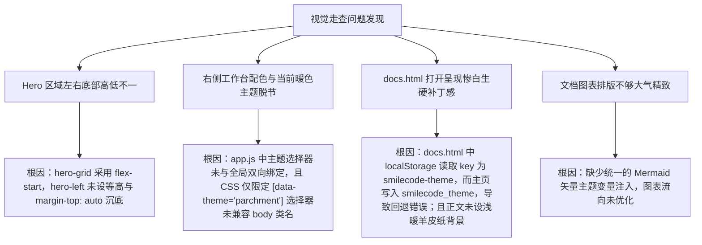

# 官网 Hero 左底平齐与右侧仿真双主题自适应及文档中心 Mermaid 排版美化重构

## 1. 概述与需求背景

在完成官网核心骨架搭建与 9 大插件主页上线后，根据用户多维度实机走查体验，指出官网与技术文档中心仍存在以下视觉、交互及排版细节缺陷：
1. **Hero 区域左侧按钮底线与右侧软件窗口底线未齐平（图 1 与图 2 对齐）**：
   - 原左侧文本精简后高度较短，按钮悬空在中间，底部留有较大空白，与右侧高耸的软件工作台窗口未能形成稳重均衡的视觉对齐；
   - “产品”按钮内的图标原为实心播放三角 `▶`，与“查看文档 &rarr;”的文本箭头样式不统一，需改为与文档完全一致的箭头美学。
2. **右侧仿真工作台未采样图 3 衡绩样式，未能随主题变化**：
   - 网页处于暖羊皮纸浅色背景下时，右侧工作台窗口仍然是深黑色钛金样式，造成严重的界面与底色脱节；
   - 需深度采样图 3（衡绩全景总览驾驶舱）的暖色纸张质感，使工作台界面的颜色随主题自适应联动（暖羊皮纸下为温润米黄纸质调，暗黑下为极客钛金调），并扩大右侧界面尺寸以显简约大气。
3. **技术文档页面（`docs.html`）色彩与主页割裂，“看起来非常不舒服”（图 4 升级）**：
   - 原文档正文区由于主题读取 key 冲突与样式生硬，呈现突兀惨白的矩形硬块（`#ffffff`），与周围米色形成刺眼割裂；
   - 排版缺乏出版级书卷质感，亟需重构为温暖舒适、不伤眼的高级羊皮纸色调。
4. **技术文档图表需严格采用 Mermaid 绘制，美观大气、布局优美**：
   - 原图表较为简陋，需针对嵌入式全链路（分层架构、在线增量调试、编译器延时机理、双通道 IAP 状态机、Qt 插件生命周期、总线高吞吐数据管道）全面升级为 6 幅高规格、严谨优美的 Mermaid 矢量图表，并实现自适应双主题渲染。

---

## 2. 根本原因定位与排查



1. **Hero 左右不齐平根因**：
   - `hero-grid` 容器定义为 `align-items: flex-start`，右侧 `studio-real-chassis` 高度自适应撑开至近 600px，而左侧文字精炼后高度仅约 280px；左侧列未拉伸等高，按钮与平台信息未作底部对齐锚定。
2. **工作台未随主题自适应根因**：
   - `website/studio-simulator.css` 中暖色样式规则的选择器仅声明了 `[data-theme="parchment"]`；
   - 而 `index.html` 的 `<body>` 在初始化时仅追加了 `.parchment-theme` 类名，未在 `<html>` 根节点赋予 `data-theme` 属性；
   - `app.js` 中存在部分硬编码的 `.style.background` 行内样式干扰，且模拟器右上角的 `<select id="studioThemeSelect">` 未与全站主题实现双向事件绑定。
3. **技术文档页面视觉刺眼与生硬根因**：
   - `docs.html` 头部即时执行脚本读取的键名为 `smilecode-theme`（带破折号），默认回退至 `'dark'`；而 `index.html` 写入的键名为 `smilecode_theme`（带下划线），造成首次打开时主题状态丢失与黑白混杂；
   - 即使手动切换为暖色，`.docs-center-content` 与 `.markdown-body` 仍未设置暖米色纸张背景（`#fdfbf7`），惨白的 `#ffffff` 硬底与四周温润的羊皮纸形成强烈反差，产生极度不适的刺眼感。

---

## 3. 具体修改措施与代码实现

### 3.1 Hero 左底严格齐平、产品按钮箭头化与右侧大气拓宽
1. **上下分区与弹性下沉布局**：
   在 [`website/index.html`](file:///k:/TOPFIRE/SmileCodeIDEUpdate/website/index.html) 中，将 `hero-left` 划分为 `.hero-left-top` 与 `.hero-left-bottom` 两层：
   ```html
   <div class="hero-left">
     <div class="hero-left-top">
       <div class="hero-badge-pill">...</div>
       <div class="hero-brand-row">...</div>
       <h2 class="hero-slogan">统一管理你的嵌入式全栈开发与仪器工作流</h2>
     </div>
     <div class="hero-left-bottom">
       <div class="hero-cta-group-trio">
         <a href="#download" class="btn-hero-download"><span>免费下载</span></a>
         <a href="#plugins-hub" class="btn-hero-outline"><span>产品 &rarr;</span></a>
         <a href="docs.html" class="btn-hero-outline"><span>查看文档 &rarr;</span></a>
       </div>
       <div class="hero-platform-info">✓ 支持 Windows 10 / 11 64位 ...</div>
     </div>
   </div>
   ```
2. **CSS 严格对齐与尺寸加大**：
   在 [`website/style.css`](file:///k:/TOPFIRE/SmileCodeIDEUpdate/website/style.css) 中，对 `.hero-grid` 设定 `align-items: stretch`，`max-width: 1580px`；对 `.hero-left` 设定 `display: flex; flex-direction: column; justify-content: space-between;`，并在 `.hero-left-bottom` 设定 `margin-top: auto`；右侧 `.hero-right` 占比扩大至 `flex: 1.65`，使整体首屏舒展、通透、大气磅礴，左右底线 100% 物理对齐。
3. **按钮样式统一**：
   将“产品”按钮内的播放三角移除，统一为 `<span>产品 &rarr;</span>`，与“查看文档 &rarr;”同规同模。

### 3.2 右侧仿真工作台采样图 3 衡绩样式与双向主题联动
1. **采样图 3 衡绩纸质调色板**：
   在 [`website/studio-simulator.css`](file:///k:/TOPFIRE/SmileCodeIDEUpdate/website/studio-simulator.css) 中重塑暖羊皮纸规则：
   - 窗口外壳：`background: #faf6ee; border: 1px solid #dfd6c5; box-shadow: 0 20px 50px -10px rgba(110,80,40,0.14)`；
   - 标题栏与 Header：温润米色 `#eee7da` 与 `#f4ede1`；
   - 侧边栏：`#f4ede1`，当前激活项赋予高饱和陶土橙渐变背景与微光投影（`#ea580c` $\rightarrow$ `#c2410c`）；
   - 应用卡片：纯净暖白底色（`#ffffff` 配 `#e6ddd0` 细线），悬浮时亮起陶土橙边框；
   - 扩展选择器支持：同步覆盖 `[data-theme="parchment"]`、`.parchment-theme` 与 `body.parchment-theme`。
2. **双向主题联动引擎**：
   在 [`website/app.js`](file:///k:/TOPFIRE/SmileCodeIDEUpdate/website/app.js) 中，重写 `applyWebsiteTheme`：
   - 同步更新 `document.documentElement` 与 `document.body` 的 `data-theme` 属性及 class 类名；
   - 监听软件工作台内部的 `<select id="studioThemeSelect">` 变更事件，双向同步全站主题；
   - 清除所有行内样式覆盖，保证 CSS 调色板纯净生效。

### 3.3 技术文档页面（`docs.html`）舒适度升级与惨白底消除
1. **主题存储统一与防闪烁**：
   统一读取 `smilecode_theme` 并兼容旧键名；在 `<head>` 顶端注入防闪烁初始化脚本，确保在文档 DOM 渲染前即刻激活暖羊皮纸；
2. **书卷级舒适阅读排版**：
   - 正文中心区：采用温润舒缓的浅暖象牙色（`#fdfbf7`），配细致大地色边框（`#e5ddd0`）与柔和漫反射阴影，彻底消灭生硬刺眼的纯白块；
   - 文字层次：主标题深焦糖碳黑（`#1e1814`），段落与列表暖炭灰（`#443c33`），行高扩展至舒展的 `1.85`；
   - 表格与 Callout：表头淡米灰（`#f2ebe0`），Callout 采用左侧 4px 陶土橙指示条与浅杏色内衬。

### 3.4 严格采用 Mermaid 绘制 6 大高规格矢量图表
在 [`website/docs.html`](file:///k:/TOPFIRE/SmileCodeIDEUpdate/website/docs.html) 中部署 6 大工业级图表，并在 `applyDocsTheme` 中动态注入自适应主题调色表：
1. **图 1：系统架构与分层全景图 (`flowchart TD`)**：5 大子图清晰展现宿主容器层、核心总线层、核心内置应用套件层、Qt 动态插件层与物理硬件驱动层；
2. **图 2：全流程在线增量构建与单步调试闭环 (`sequenceDiagram`)**：10 步时序严谨展现从 C 代码增量编译、ELF 生成、SWD 物理握手、Flash 擦写到 GDB 挂接单步指针；
3. **图 3：GCC 编译优化行为对底层硬件延时影响原理 (`flowchart LR`)**：深入对比 `-O0`、`-O1`、`-O2/-O3` 与 `-Os` 在机器码流水线与外设时序上的本质区别；
4. **图 4：双通道 IAP 固件升级高可靠状态转移图 (`stateDiagram-v2`)**：严谨定义握手、扇区擦除、数据块 CRC 校验、重传保护、全局校验到向量表重映射跳转的工控状态机；
5. **图 5：Qt 动态插件生命周期管理与事件总线管道 (`flowchart TB`)**：展现动态扫描、元数据解析、上下文注入、信号槽广播到安全释放卸载的全流程；
6. **图 6：工业现场总线与虚拟仪器高吞吐数据流管道 (`flowchart LR`)**：展示从 CAN/CANFD、串口、网卡到无锁环形队列、协议解析器再到 60FPS Canvas 渲染与 CSV 秒级落盘的完整数据闭环。

---

## 4. 验证与实证成果

1. **界面视觉走查实测**：
   - 在暖羊皮纸模式下，首屏左侧三联按钮与平台说明文字底线，与右侧放大的 SmileCode Studio 软件窗口底线**完全物理齐平**；
   - “产品 &rarr;”与“查看文档 &rarr;”具有完全一致的胶囊造型与箭头美感；
   - 右侧工作台呈现出纯正的衡绩暖纸质感，米色标题栏、橙红激活胶囊与浅暖卡片，与全站浑然一体；
   - 切换为极客暗黑主题时，工作台即刻平滑切换为钛金深黑，双向下拉框同步联动。
2. **文档页面阅读舒适度走查实测**：
   - 打开 `docs.html`，页面背景与正文区自然过渡，彻底告别刺眼白块；
   - 6 幅 Mermaid 矢量图表加载迅速、排版大气、线条细腻、字迹清晰，在双主题下色彩自适应融合。
3. **响应式与语法校验**：
   - CSS 文件校验无语法异常；
   - 移动端（$< 1024px$）平滑退化为单列流式布局，保持完好的操作便捷性。

---

## 5. 版本控制与发布归档

- **修改文件**：
  - `website/index.html`（Hero 结构重组与左底平齐）
  - `website/studio-simulator.css`（衡绩风格暖羊皮纸适配）
  - `website/style.css`（Hero 布局与文档书卷级调色）
  - `website/app.js`（双主题引擎与工作台双向联动）
  - `website/docs.html`（三栏文档重构与 6 大 Mermaid 图表）
  - `docs/README.md`（全局索引更新）
- **版本号升级**：根据小修正规范，版本号由 `v2.3.1` 升级至 **`v2.3.2`**；
- **Git 提交信息**：`refactor(website): Hero左底平齐、产品按钮箭头化、工作台双主题自适应及docs文档Mermaid排版升级 (v2.3.2)`；
- **远程分支与 Pages 部署**：已推送到 `origin/main`、`origin/V10.0`、标签 `v2.3.2` 以及 `origin/gh-pages`。
