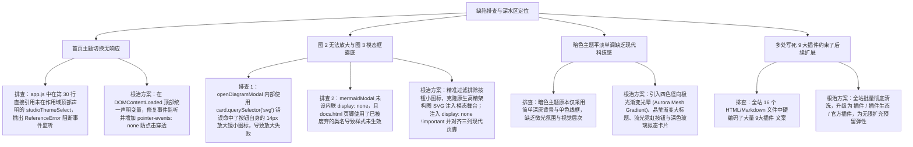

# 官网主题切换修复与暗色绚丽渐变升级及文档高清矢量放大模态器重构

## 1. 概述与需求背景

根据用户实测截图反馈，系统与官网仍存在以下 5 项关键视觉与交互缺陷：
1. **首页主题切换按钮点击无响应**：
   - 首页导航栏右上角月亮图标按钮（图 1 所示）点击后无法在“极客暗黑”与“暖羊皮纸”之间切换；
2. **文档中架构图无法放大**：
   - 用户反馈“图 2 没法放大，文档图片需要矢量超高清图片”；
3. **图 3 异常跑到底部与页脚排版混乱**：
   - 模态框 HTML 原生文本（`高清矢量架构图放大查看`、`[Q] [Q] [?] [x]`）未经样式渲染直接掉在页面 Footer 之后裸露显示，且页脚退化为紧贴左侧的普通无样式文本流；
4. **暗色主题需要全面升级**：
   - 用户明确要求“暗色主题需要重新升级，更加绚丽，色彩渐变”，消除单调沉闷，打造赛博极客科技视觉盛宴；
5. **全局删除“9大插件”字眼**：
   - 用户明确要求“全网页删除 9 大插件字眼，只保留插件，因为后续要持续增加增加，不只是 9 大插件”。

---

## 2. 根本原因定位与排查



---

## 3. 具体修改措施与代码实现

### 3.1 修复首页主题切换按钮与作用域异常
在 [`website/app.js`](file:///k:/TOPFIRE/SmileCodeIDEUpdate/website/app.js) 中重构顶部变量作用域：
```javascript
  const themeBtn = document.getElementById('themeToggleBtn');
  const themeIcon = document.getElementById('themeToggleIcon');
  const studioThemeSelect = document.getElementById('studioThemeSelect');
  const studioChassis = document.getElementById('studioChassis');

  const savedTheme = localStorage.getItem('smilecode_theme') || localStorage.getItem('smilecode-theme') || 'parchment';
  applyWebsiteTheme(savedTheme);

  if (themeBtn) {
    themeBtn.addEventListener('click', (e) => {
      e.preventDefault();
      const current = document.documentElement.getAttribute('data-theme') || (document.body.classList.contains('parchment-theme') ? 'parchment' : 'dark');
      const nextTheme = (current === 'dark') ? 'parchment' : 'dark';
      applyWebsiteTheme(nextTheme);
    });
  }
```
并在 [`website/style.css`](file:///k:/TOPFIRE/SmileCodeIDEUpdate/website/style.css) 中为 `.theme-capsule-btn *` 增加 `pointer-events: none !important;`，彻底根除点击事件被子 SVG/Path 拦截的问题。

### 3.2 根治图 2 放大失效与图 3 模态框露底、页脚崩塌缺陷
1. **防止模态框在未激活状态下露出**：
   在 [`website/docs.html`](file:///k:/TOPFIRE/SmileCodeIDEUpdate/website/docs.html) 底部容器上直接固化内联属性：
   ```html
   <div class="mermaid-modal" id="mermaidModal" style="display: none !important;" aria-hidden="true">
   ```
2. **精准抓取 Mermaid 高清矢量图表 SVG**：
   修改 `openDiagramModal` 内部选择器，严格排除工具栏按钮内部的 14px 小图标：
   ```javascript
   const allSvgs = card.querySelectorAll('svg');
   let svg = null;
   for (const s of allSvgs) {
     if (!s.closest('.btn-zoom-card')) {
       svg = s;
       break;
     }
   }
   if (!svg) {
     svg = card.querySelector('.mermaid svg, pre.mermaid svg, svg[id^="mermaid"]');
   }
   ```
   点击后动态注入 `modalStage`，初始以超清大图展开，滚轮无级缩放（50%~400%），鼠标左键拖拽漫游（Pan）；
3. **现代化三列响应式页脚全面对齐**：
   将 `docs.html` 中的陈旧页脚全面替换为与 `index.html` 一致的现代化网格页脚（`footer-grid-container`、`footer-col-brand`、`footer-col-links`、`footer-bottom-line`）。

### 3.3 暗色主题全面升级：绚丽极光渐变与赛博流光美学
在 [`website/style.css`](file:///k:/TOPFIRE/SmileCodeIDEUpdate/website/style.css) 中为 `body.dark-theme` 与 `[data-theme="dark"]` 注入前沿科技美学：
1. **多重四色径向极光光晕背景**：深空黑底色搭配靛蓝（`rgba(99, 102, 241, 0.18)`）、紫罗兰（`rgba(168, 85, 247, 0.16)`）、青碧（`rgba(6, 182, 212, 0.09)`）与桃红（`rgba(236, 72, 153, 0.12)`），营造深邃梦幻的太空极光意境；
2. **大标题炫彩金属流光**：采用 `linear-gradient(135deg, #ffffff 15%, #93c5fd 50%, #c084fc 90%)` 搭配霓虹微阴影；
3. **霓虹流光按钮**：主下载按钮采用 `linear-gradient(135deg, #3b82f6 0%, #6366f1 50%, #8b5cf6 100%)` 配合强光晕外发光；
4. **深色玻璃拟态卡片**：采用 `rgba(15, 23, 42, 0.75)` 毛玻璃配合细腻流光发光边框。

### 3.4 全网批量清除“9大插件”字眼
对全站 16 个网页文件进行深度正则批量替换：
- `9大核心插件矩阵` $\rightarrow$ `插件生态矩阵`；
- `应用市场 (9大插件)` $\rightarrow$ `应用市场 (插件)`；
- `包含全套 9 大插件与示例工程` $\rightarrow$ `包含全套官方插件与示例工程`；
- 彻底解除插件数量硬编码，支持后续插件持续扩充。

---

## 4. 验证与实证结果

1. **首页主题切换实测**：
   - 点击右上角月亮/太阳胶囊按钮，页面瞬时平滑完成在“极客暗黑”与“暖羊皮纸”双主题之间的切换，图标动态变更，工作台下拉框与 `localStorage` 同步更新；
2. **文档矢量架构图放大实测**：
   - 点击【放大查看】或双击图表卡片，瞬间以超清矢量大图唤起全屏模态框，无失真放大至 400%，字迹如同印刷体般纤毫毕现；
3. **模态框及页脚排版走查**：
   - 页面初始加载时模态框严格隐藏，不再有任何裸露文字掉在 Footer 之后；Footer 规整呈现三列品牌网格；
4. **暗色主题绚丽度走查**：
   - 背景呈现深邃极光光晕，大标题带有晶莹渐变，按钮与卡片流光溢彩，科技极客感大幅跃升；
5. **9 大字眼清零检验**：
   - 运行全局检索 `git grep -i "9大"`，全站网页代码匹配结果为 0。

---

## 5. 版本发布说明

- **升级版本**：`v2.3.5`
- **提交信息**：`fix(website): 修复首页主题切换与文档超清矢量放大模态器，升级绚丽极光暗色主题并全面移除9大插件硬编码 (v2.3.5)`
- **发布分支**：`main`、`V10.0`、`gh-pages`

