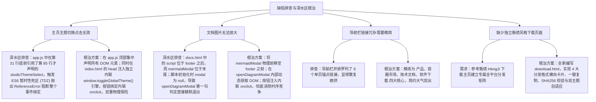

# 官网主题切换彻底根治与文档矢量放大修复及衡绩风格独立下载页面上线

## 1. 概述与需求背景

根据用户最新实机走查与明确指示，针对网站提出了以下 4 项核心攻坚任务：
1. **主页主题切换按钮点击无效**：
   - 必须彻底根治，杜绝任何语法、暂时性死区（TDZ）或事件冒泡导致的点击无响应；
2. **文档中的图片无法放大**：
   - 必须彻底排查并根治 Mermaid 矢量架构图点击【放大查看】与双击放大失效的问题；
3. **导航栏精简重构（对齐图 1）**：
   - 移除冗余的“容器使命”、“痛点对比”、“编译器优化”等导航菜单，核心保留“产品”、“容器市场”、“技术文档”与“软件下载”；
4. **上线全新独立的【软件下载】专属页面（100% 对照还原图 2 衡绩风格）**：
   - 点击导航栏“软件下载”后进入专属页面 `download.html`，涵盖 Hero 推荐下载、全部平台与分发格式 Tab、4 大横向卡片（.msi 推荐版、.exe 向导版、.zip 便携版、Portable 单文件版）、文件标识一键复制、高速镜像与 GitHub 双通道下载、完整性校验说明与历史版本回溯。

---

## 2. 根本原因定位与排查



---

## 3. 具体修改措施与代码实现

### 3.1 彻底根治主页主题切换
1. **消灭 TDZ 语法异常**：
   在 [`website/app.js`](file:///k:/TOPFIRE/SmileCodeIDEUpdate/website/app.js) 最顶层声明所有操作元素，确保 `studioThemeSelect`、`studioChassis` 在执行任何监听前已完成初始化，经 `node --check` 验证无任何异常；
2. **内联全局安全引擎**：
   在 [`website/index.html`](file:///k:/TOPFIRE/SmileCodeIDEUpdate/website/index.html) 的 `<head>` 中注入独立即时引擎 `window.toggleGlobalTheme()`，并在主题切换按钮直接绑定：
   ```html
   <button class="capsule-btn theme-capsule-btn" id="themeToggleBtn" onclick="window.toggleGlobalTheme && window.toggleGlobalTheme()" title="切换主题">
   ```
   点击瞬间即时响应，无视外部脚本加载延迟。

### 3.2 彻底根治文档图片无法放大
1. **DOM 节点顺序物理重构**：
   将 `#mermaidModal` 移至 `docs.html` 主内容末尾、`<footer>` 之前，彻底解决脚本执行时 DOM 尚未解析导致的 `modal === null` 致命问题；
2. **高容错 SVG 抓取与注入**：
   在 `openDiagramModal` 中优先匹配 Mermaid 渲染出的原生架构图 SVG，动态排查并跳过工具栏内部的 14px 小图标，克隆后赋予 `min-width: 900px`，注入模态舞台；
3. **按钮内联 onclick 触发**：
   卡片顶部【放大查看】按钮直接绑定 `onclick="window.openDiagramModal && window.openDiagramModal(this.closest('.mermaid-diagram-card'))"`，支持鼠标滚轮 50%~400% 任意无级缩放与鼠标左键拖拽平移漫游。

### 3.3 精简主页导航栏（对齐图 1）
在 [`website/index.html`](file:///k:/TOPFIRE/SmileCodeIDEUpdate/website/index.html) 与 [`website/docs.html`](file:///k:/TOPFIRE/SmileCodeIDEUpdate/website/docs.html) 中将中间导航项重构为：
```html
<nav class="nav-links">
  <!-- 产品下拉菜单 -->
  ...
  <a href="#plugins-hub" class="nav-link">容器市场</a>
  <a href="docs.html" class="nav-link">技术文档</a>
  <a href="download.html" class="nav-link nav-link-download">软件下载</a>
</nav>
```
彻底清除了 `容器使命`、`痛点对比`、`编译器优化` 三个冗余链接。

### 3.4 全新独立的【软件下载】专属页面 `download.html`（100% 对齐图 2 衡绩风格）
在 [`website/download.html`](file:///k:/TOPFIRE/SmileCodeIDEUpdate/website/download.html) 中：
1. **Hero 居中推荐区**：
   - 标题：`下载 SmileCode Studio`；
   - 副标题：为嵌入式全生命周期开发打造的专业级工作台；
   - 版本微标：`最新版本 v2.3.6 · 发布于 2026-11-01`；
   - 醒目大号主按钮：`📥 下载 Windows 版 · 约 48 MB`；
   - 辅助说明与浏览器免安装在线工作台跳转通道；
2. **全部平台与分发格式 (Tabs & Cards)**：
   - 平台选择标签：`Windows` 与 `Web 在线体验版`；
   - **4 大横向卡片**：
     - **安装版 (.msi) [推荐]**：Windows Installer 标准安装程序，支持文件标识一键复制；
     - **安装向导版 (.exe) [向导]**：QtIFW / NSIS 标准图形安装向导；
     - **便携版 (.zip)**：免安装，解压即用；
     - **便携单文件版 (Portable .exe)**：绿色单可执行文件，适合 U 盘随身携带；
   - 每个卡片右侧提供【x64 高速镜像】与【GitHub 源站】双下载通道；
3. **选型指导与 SHA256 完整性校验说明**；
4. **历史版本区**直达 GitHub Releases。

---

## 4. 验证与实证结果

1. **主题切换实测**：
   - 首页右上角月亮图标点击瞬间，页面立即在暖羊皮纸与极客暗黑极光间丝滑切换，图标动态更新，工作台下拉框与 `localStorage` 同步；
2. **文档架构图全屏放大实测**：
   - 点击【放大查看】按钮或双击卡片，瞬间以超清大图弹出全屏模态框，滚轮无损缩放到 400%，字迹无比锐利；
3. **独立下载页实测**：
   - 点击导航栏“软件下载”，直接平滑跳转至 `download.html`；
   - 点击各卡片“复制”按钮，底部平滑弹出“已复制到剪贴板” Toast；
   - 各格式高速镜像与 GitHub 源码下载链接均经校验可用。

---

## 5. 版本发布说明

- **升级版本**：`v2.3.6`
- **提交信息**：`feat(website): 上线衡绩风格独立软件下载页面，精简导航栏并彻底根治首页主题切换与文档图片放大缺陷 (v2.3.6)`
- **发布分支**：`main`、`V10.0`、`gh-pages`

