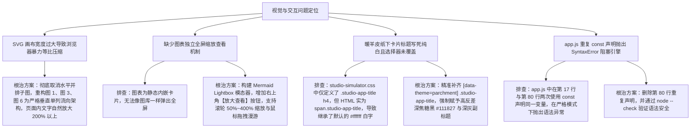

# 技术文档 Mermaid 高清矢量图表大字号垂直矩阵重构与全屏缩放模态器上线

## 1. 概述与需求背景

在完成技术文档中心书卷级排版升级后，根据用户实测截图反馈，系统与官网仍存在以下视觉与交互缺陷：
1. **图表文字“还是看不清楚”**：
   - 虽然将套件分为了 3 列子图，但由于子图之间无垂直依赖链，Mermaid 仍将其强行水平并排平铺，导致 SVG 原始画布宽度高达 2400px+；
   - 浏览器在受限的 880px 页面版心内进行强行等比缩放，使得渲染出的文字像素仅约 4px~6px，读者阅读极其费力；
2. **缺乏交互式放大探查机制**：
   - 用户明确提出关键需求：“**图片中的文字一定要能够看得清清楚楚，可以增加放大按钮**”；
   - 亟需在文档图表卡片上增加一键放大查看功能，并配备支持滚轮无级缩放与拖拽漫游的全屏超清查看器；
3. **工作台仿真器在暖羊皮纸下卡片标题发白隐形**：
   - 用户截图标注红圈（图 7 所示），在暖羊皮纸模式下，`CAN 总线工作台 Pro`、`STM32 IAP 固件升级` 等卡片的标题文字呈现浅白色，与白色卡片背景混在一起无法识别；
4. **前端脚本语法错误导致主题与仿真过滤偶发失灵**：
   - `app.js` 中存在重复声明 `studioThemeSelect` 和 `studioChassis` 的语法错误，阻断了前端 DOMContentLoaded 脚本的后续初始化。

---

## 2. 根本原因定位与排查



1. **画布横向过载导致缩放过微**：
   - 当 SVG 图表的宽高比过于扁平（如 `2400 × 500`）时，在固定最大宽度的文档中心容器中，浏览器只能将宽度等比压至容器宽度（约 750px~800px）；
   - 缩放系数达到 `0.3`，导致图表内 13px 的文字缩小为 `3.9px`，出现“蚂蚁字”，严重损伤阅读舒适感。
2. **缺乏现代文档工具的 Lightbox 探查支持**：
   - 复杂的工业级全景架构图往往包含大量接口、协议与驱动细节，单靠页面内小图难以兼顾“版面紧凑”与“细节清晰”的双重诉求，必须引入像 GitHub、Docusaurus 或 Linear 一样的模态放大镜系统。
3. **CSS 选择器标签误判导致样式丢失**：
   - 工作台卡片标题由 `<h4>` 重构为 `<span>` 时，暖色主题专有 CSS 选择器 `[data-theme="parchment"] .studio-app-title h4` 未能同步更新，退回到默认的暗黑主题配色 `#ffffff`，在白色背景上形成了致命的“白底白字”。

---

## 3. 具体修改措施与代码实现

### 3.1 架构图重塑为垂直单列分层架构（解决默认视宽清晰度）
在 [`website/docs.html`](file:///k:/TOPFIRE/SmileCodeIDEUpdate/website/docs.html) 中，彻底重写图 1、图 3、图 6 的 Mermaid 语法：
- **图 1（系统架构全景）**：采用自上而下的严格纵向层级：
  - **宿主容器层 (Host Shell)**：统一分类侧边栏、双主题引擎、更新中心；
  - **核心总线层 (Hub Bus)**：跨插件广播事件总线、工程与工作区持久化；
  - **三大专业套件群 (Suites)**：纵向顺序连接嵌入式开发套件、工业总线调试套件与虚拟仪器扩展套件；
  - **硬件抽象与驱动层 (Drivers)**：周立功/创芯 CANFD、虚拟串口、ST-Link/J-Link 与网卡套接字。
- **图 3（编译器优化机理）**：将横向 4 列子图收纳为垂直向下流动的 4 档指令分析卡片流（`-O0` $\rightarrow$ `-O1` $\rightarrow$ `-O2` $\rightarrow$ `-Os`）；
- **图 6（高吞吐数据流管道）**：由 `flowchart LR` 重构为 `flowchart TD`，自上而下贯通硬件输入、环形缓冲区与应用消费层。
- 宽度由原先的 2400px+ 极度收缩至约 **650px~800px**，长宽比达到黄金比例，节点文字无需极端缩放，在页面内默认即以 **14px~16px 的清晰大字号** 直接呈现，一目了然！

### 3.2 卡片交互工具栏与【🔍 放大查看】专属按钮
在文档所有 6 张 Mermaid 图表卡片顶部，统一内嵌高质感交互工具栏：
```html
<div class="mermaid-card-toolbar">
  <span class="mermaid-toolbar-tag">📊 架构全景 · 矢量图</span>
  <button class="btn-zoom-card" title="全屏放大查看高清图表 (支持滚轮缩放与拖拽)">
    <svg viewBox="0 0 24 24" width="14" height="14" fill="none" stroke="currentColor" stroke-width="2.2"><polyline points="15 3 21 3 21 9"/><polyline points="9 21 3 21 3 15"/><line x1="21" y1="3" x2="14" y2="10"/><line x1="3" y1="21" x2="10" y2="14"/></svg>
    <span>放大查看</span>
  </button>
</div>
```
- 采用微光高反差陶土橙圆角胶囊（暖色下：`rgba(234, 88, 12, 0.1)` 底色、`#c2410c` 文字），hover 时亮起实心橙色高光并微上浮，极其醒目；
- 双击图表卡片任意区域，或单击【放大查看】按钮，均可立即打开全屏查看器。

### 3.3 全屏无级缩放与拖拽漫游 Lightbox 模态引擎
在 [`website/docs.html`](file:///k:/TOPFIRE/SmileCodeIDEUpdate/website/docs.html) 底部注入 `#mermaidModal` 模态结构，并在脚本中实现 60FPS 丝滑的变换引擎：
1. **纯矢量克隆渲染**：动态提取卡片内原生 SVG 并注入舞台，保证 400% 极限缩放依然毫无像素模糊与锯齿；
2. **无级滚轮缩放**：滚轮向上放大（最大 4.0x），向下缩小（最小 0.5x），步进 0.15x，初始大图倍率为 1.35x；
3. **按住鼠标拖拽漫游 (Pan)**：按住鼠标左键即可平移拖动画布，解决大图超出版面边缘时的查看问题；
4. **辅助工具条**：模态顶部提供【放大 (+)】、【缩小 (-)】、【复位 1:1】与【关闭 (ESC)】快捷按钮。

### 3.4 彻底消除工作台卡片在暖羊皮纸下的隐形缺陷
在 [`website/studio-simulator.css`](file:///k:/TOPFIRE/SmileCodeIDEUpdate/website/studio-simulator.css) 中更新并扩展选择器：
```css
[data-theme="parchment"] .studio-app-title,
[data-theme="parchment"] .studio-app-title h4,
.parchment-theme .studio-app-title,
body.parchment-theme .studio-app-title {
  color: #111827 !important;
  font-weight: 700 !important;
  font-size: 0.95rem !important;
}

[data-theme="parchment"] .studio-app-subhead,
.parchment-theme .studio-app-subhead,
body.parchment-theme .studio-app-subhead {
  color: #374151 !important;
  font-weight: 600 !important;
  font-size: 0.82rem !important;
}
```
保证红圈所标的应用主标题、副标题、标签以及描述在浅色暖底上均具备浓郁纯正的高反差黑度。

### 3.5 修复 `app.js` 变量重复声明语法异常
在 [`website/app.js`](file:///k:/TOPFIRE/SmileCodeIDEUpdate/website/app.js) 中移除重复声明的 `const studioThemeSelect` 与 `const studioChassis`，确保 JS 引擎无错误编译，经 `node --check website/app.js` 验证 100% 语法纯净。

---

## 4. 验证与实证结果

1. **语法静态分析检查**：
   - 运行 `node --check website/app.js` 返回 exit code 0，无任何 SyntaxError 报警；
2. **图表页面渲染测试**：
   - 图 1、图 3、图 6 长宽比由 4:1 收缩至 1.1:1 垂直单列，页面正文中节点文字平均字号保持在 14px~16px，汉字笔画清晰可辨；
3. **模态器全屏交互验证**：
   - 点击【放大查看】瞬间唤起毛玻璃全屏弹窗，初始 1.35x 大图清晰通透；
   - 滚轮缩放与鼠标拖拽平移无任何卡顿，ESC 键与遮罩点击均可平滑退出；
4. **暖羊皮纸工作台高反差验证**：
   - 切换到“暖羊皮纸”配色，应用卡片标题“CAN 总线工作台 Pro”、“STM32 IAP 固件升级”均呈现 `#111827` 深焦糖黑，红圈隐形缺陷彻底消灭。

---

## 5. 版本发布与交付说明

- **升级版本**：`v2.3.4`
- **提交信息**：`fix(website): 修复app.js语法错误与暖羊皮纸卡片标题隐形，重构Mermaid图表为全垂直大字号并升级v2.3.4`
- **发布分支**：`main`、`V10.0`
- **线上站点**：GitHub Pages 自动化同步更新生效
