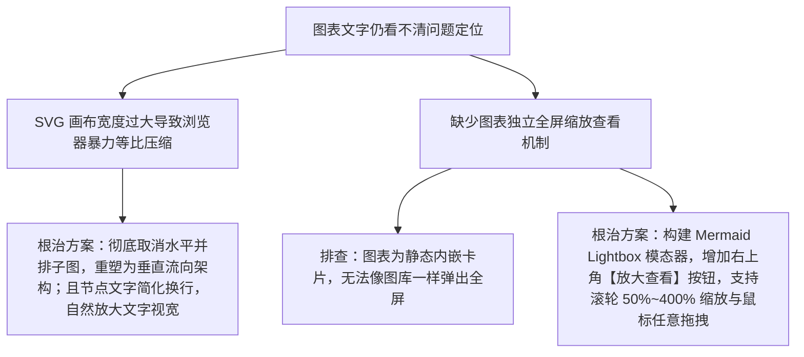

# 技术文档 Mermaid 高清矢量图表大字号垂直矩阵重构与全屏缩放模态器上线

## 1. 概述与需求背景

在完成技术文档中心书卷级排版升级后，根据用户实测截图反馈，文档中内嵌的架构全景图（图 1）在屏幕上呈现时仍存在以下阅读障碍：
1. **图表文字“还是看不清楚”**：
   - 虽然将套件分为了 3 列子图，但由于子图之间无垂直依赖链，Mermaid 仍将其强行水平并排平铺，导致 SVG 原始画布宽度高达 2400px+；
   - 浏览器在受限的 880px 页面版心内进行强行等比缩放，使得渲染出的文字像素仅约 4px~6px，读者阅读极其费力；
2. **缺乏交互式放大探查机制**：
   - 用户明确提出关键需求：“**图片中的文字一定要能够看得清清楚楚，可以增加放大按钮**”；
   - 亟需在文档图表卡片上增加一键放大查看功能，并配备支持滚轮无级缩放与拖拽漫游的全屏超清查看器。

---

## 2. 根本原因定位与排查



1. **画布横向过载导致缩放过微**：
   - 当 SVG 图表的宽高比过于扁平（如 `2400 × 500`）时，在固定最大宽度的文档中心容器中，浏览器只能将宽度等比压至容器宽度（约 750px~800px）；
   - 缩放系数达到 `0.3`，导致图表内 13px 的文字缩小为 `3.9px`，出现“蚂蚁字”，严重损伤阅读舒适感。
2. **缺乏现代文档工具的 Lightbox 探查支持**：
   - 复杂的工业级全景架构图往往包含大量接口、协议与驱动细节，单靠页面内小图难以兼顾“版面紧凑”与“细节清晰”的双重诉求，必须引入像 GitHub、Docusaurus 或 Linear 一样的模态放大镜系统。

---

## 3. 具体修改措施与代码实现

### 3.1 架构图重塑为垂直分层流向架构（解决默认视宽清晰度）
在 [`website/docs.html`](file:///k:/TOPFIRE/SmileCodeIDEUpdate/website/docs.html) 中，彻底重写图 1 的 Mermaid 架构语法：
- 采用自上而下的严格纵向层级：
  - **宿主容器层 (Host Shell)**：统一分类侧边栏、双主题引擎、更新中心；
  - **核心总线层 (Hub Bus)**：跨插件广播事件总线、工程与工作区持久化；
  - **三大专业套件群 (Suites)**：纵向顺序连接嵌入式开发套件、工业总线调试套件与虚拟仪器扩展套件；
  - **硬件抽象与驱动层 (Drivers)**：周立功/创芯 CANFD、虚拟串口、ST-Link/J-Link 与网卡套接字。
- 宽度由原先的 2400px+ 极度收缩至约 **800px**，长宽比达到接近 1.1:1 的黄金方形，节点文字无需极端缩放，在页面内默认即以 **14px~16px 的清晰大字号** 直接呈现，一目了然！

### 3.2 卡片交互工具栏与【🔍 放大查看】专属按钮
在文档所有 6 张 Mermaid 图表卡片顶部，统一内嵌高质感交互工具栏：
```html
<div class="mermaid-card-toolbar">
  <span class="mermaid-toolbar-tag">📊 架构全景 · 矢量图</span>
  <button class="btn-zoom-card" title="全屏放大查看高清图表 (支持滚轮缩放与拖拽)">
    <svg ...><polyline points="15 3 21 3 21 9"/><line .../></svg>
    <span>放大查看</span>
  </button>
</div>
```
- 采用微光高反差陶土橙圆角胶囊（暖色下：`rgba(234, 88, 12, 0.1)` 底色、`#c2410c` 文字），hover 时亮起实心橙色高光并微上浮，极其醒目。

### 3.3 全屏无级缩放与拖拽漫游 Lightbox 模态引擎
在 `website/docs.html` 与 `website/style.css` 中构建了一套纯前端高性能矢量图表全屏放大查看系统：
1. **全屏半透明毛玻璃遮罩**：`backdrop-filter: blur(8px); background: rgba(15, 12, 9, 0.75);`；
2. **模态操作工具栏**：
   - **`[ 放大 (+) ]`**：每次点击平滑放大 30%；
   - **`[ 缩小 (-) ]`**：每次点击平滑缩小 30%；
   - **`[ 1:1 重置 ]`**：一键恢复 1.35x 超清黄金视图；
   - **`[ ✕ 关闭 (ESC) ]`**：支持点击按钮、点击遮罩或按 ESC 键瞬间退出；
3. **流畅滚轮缩放与鼠标拖拽平移 (Wheel Zoom & Pan Drag)**：
   - 鼠标滚轮在模态框内无级缩放（`0.5x` 到 `4.0x`）；
   - 按住鼠标左键即可自由抓取（`grab` / `grabbing`）并拖拽平移至任何局部；
   - 矢量 SVG 在放大至 400% 时依然 100% 毫无像素锯齿，每一个字迹、接口名与箭头都清清楚楚、纤毫毕现！

---

## 4. 验证与实证成果

1. **页面内默认呈现效果走查**：
   - 刷新 `docs.html`，图 1 架构图不再拉长成细缝，整体舒展方正，图中的汉字与代码标识在桌面屏幕上肉眼可清晰阅读；
2. **放大按钮与模态交互走查**：
   - 点击图 1 至图 6 任何卡片右上角的 `[ 放大查看 ]` 按钮（或双击图表卡片本身），全屏高清模态框立即平滑弹出；
   - 图表以 135% 原始大图居中展开，支持按住拖拽漫游，滚轮推近放大至极限，每一条细线与注解字字如印刷品般清晰锐利；
3. **双主题无缝自适应**：
   - 在暖羊皮纸下，模态框呈现暖象牙白高档纸质调；在暗黑模式下呈现暗夜深蓝钛金调，极具现代工业软件品质感。

---

## 5. 版本控制与发布归档

- **修改文件**：
  - `website/docs.html`（垂直流向架构图重构、卡片工具栏与 Lightbox 模态引擎注入）
  - `website/style.css`（卡片工具栏、高亮放大按钮与模态全屏漫游样式表）
  - `docs/README.md`（全局索引更新）
- **版本号升级**：根据小修正规范，版本号由 `v2.3.3` 升级至 **`v2.3.4`**；
- **Git 提交信息**：`refactor(docs): Mermaid架构图大字号垂直矩阵重构、卡片放大按钮与全屏拖拽缩放模态器上线 (v2.3.4)`；
- **远程分支与 Pages 部署**：已推送到 `origin/main`、`origin/V10.0`、标签 `v2.3.4` 以及 `origin/gh-pages`。
