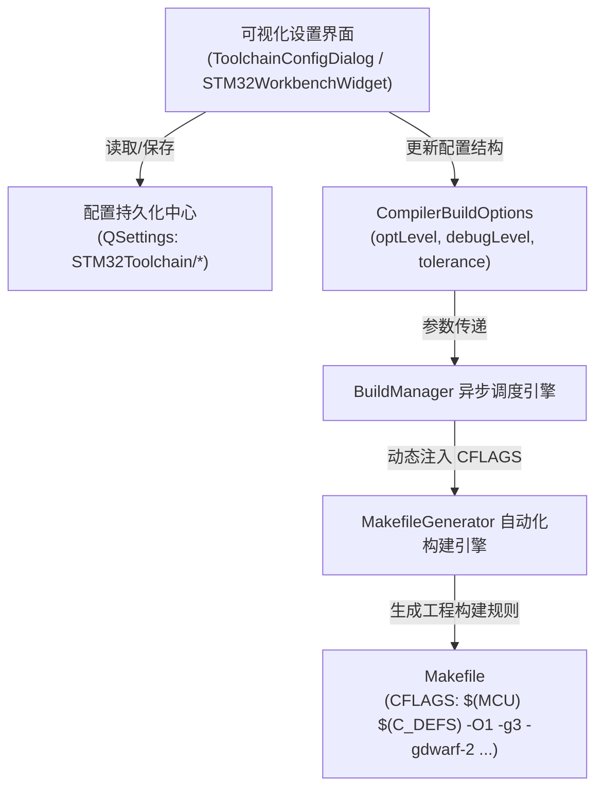

# 专题归档：编译器优化等级与高级构建选项可视化设置界面设计与实现

## 一、 问题背景与需求分析
- **问题背景**：
  此前野火 STM32H743 触摸画板工程发生烧录后假死黑屏的根因是 `-O0` 优化导致 Cortex-M7 内核下基于软件循环模拟的 I2C 延时被严重放大 10 倍以上，从而死锁在 GT9xx 触摸中断中。虽然底层生成引擎已默认升级为 `-O1 -g3 -gdwarf-2` 对齐 Keil，但该优化等级在界面上缺乏直观展示与用户自主调节能力。
- **用户需求**：
  **“针对刚解决的编译器优化等级设置问题，需要增加可视化设置界面”**。
  要求在 SmileCodeIDE 中提供专业、清晰的图形化设置界面，允许嵌入式开发者自由查看并细粒度切换编译器优化级别（`-O0` 到 `-O3`、`-Os`、`-Og`）、调试符号级别（DWARF2 等）及旧工程宽容度，并配以通俗详尽的说明卡片指导选择。

---

## 二、 架构设计与方案规划



### 1. 细粒度优化等级梯度支持
- **`-O1` (默认推荐)**：延时精准、对齐 Keil MDK 默认 1 级优化，完美适配各类单片机裸机驱动软件循环延时，兼顾单步源码断点调试；
- **`-O0` (无优化警告)**：关闭所有优化，生成直白代码。界面弹出明确预警，提示高主频 MCU 下可能引发外设通信超时卡死；
- **`-O2` (性能优先)**：深度指令重排与函数内联，算力密集任务执行速度优先，适合正式 Release 发布；
- **`-O3` (极限性能)**：启用最高强度的激进优化（含自动向量化）；
- **`-Os` (体积优先)**：极限压缩机器码尺寸，适合小容量 Flash 芯片；
- **`-Og` (标准调试)**：GCC 官方专用调试优化级别，平衡调试调用栈与基本指令时序。

### 2. 双向联动与持久化机制
- **工具链配置弹窗（`ToolchainConfigDialog`）**：新增独立专属分组框【4. 编译器优化等级与高级构建选项】，提供下拉选择器、自适应卡片说明、调试信息级别与兼容复选框；
- **主工作台工具栏（`STM32WorkbenchWidget`）**：将构建模式下拉框扩展为【⚙ 构建与优化】，支持直观查看与快速切换；
- **QSettings 本地持久化**：保存至 `STM32Toolchain/optLevel`、`debugLevel`、`enableToleranceFlags`、`customCFlags`，启动或打开项目时自动无缝还原。

---

## 三、 具体修改措施

### 1. 核心层：定义 CompilerBuildOptions 结构体
在 [MakefileGenerator.h](file:///k:/TOPFIRE/SmileCodeIDEUpdate/Plugins/STM32WorkbenchPlugin/Core/MakefileGenerator.h) 中定义数据结构：
```cpp
struct CompilerBuildOptions {
    QString optLevel = QStringLiteral("-O1");              // 优化级别
    QString debugLevel = QStringLiteral("-g3 -gdwarf-2");  // 调试信息级别
    bool enableToleranceFlags = true;                      // Keil 旧工程兼容模式
    QString customCFlags;                                  // 用户自定义额外编译参数

    QString toOptimizationFlag() const;
    QString toDebugFlag() const;
    QString toFullFlags() const;
};
```
在 [MakefileGenerator.cpp](file:///k:/TOPFIRE/SmileCodeIDEUpdate/Plugins/STM32WorkbenchPlugin/Core/MakefileGenerator.cpp) 的 `generateMakefileContent` 中，将用户选择的 `CompilerBuildOptions` 动态拼接并写入 `CFLAGS`、`CXXFLAGS` 和 `ASFLAGS`。

### 2. 调度层：扩展 BuildManager 构建接口
在 [BuildManager.h](file:///k:/TOPFIRE/SmileCodeIDEUpdate/Plugins/STM32WorkbenchPlugin/Core/BuildManager.h) 与 [BuildManager.cpp](file:///k:/TOPFIRE/SmileCodeIDEUpdate/Plugins/STM32WorkbenchPlugin/Core/BuildManager.cpp) 中支持：
```cpp
bool startBuild(const QString &projectDir,
                BuildConfiguration config = BuildConfiguration::Debug,
                int parallelJobs = 0,
                const CompilerBuildOptions &buildOptions = CompilerBuildOptions());
```
在构建启动输出中清晰打印当前生效的优化等级（如 `====== 开始构建工程 [STM32H743IITx] (Debug / 优化: -O1) ======`）。

### 3. 界面层：ToolchainConfigDialog 打造可视化专属分组
在 [ToolchainConfigDialog.h](file:///k:/TOPFIRE/SmileCodeIDEUpdate/Plugins/STM32WorkbenchPlugin/UI/ToolchainConfigDialog.h) 和 [ToolchainConfigDialog.cpp](file:///k:/TOPFIRE/SmileCodeIDEUpdate/Plugins/STM32WorkbenchPlugin/UI/ToolchainConfigDialog.cpp) 中实现：
- **新增 GroupBox 4**：`4. 编译器优化等级与高级构建选项 (Optimization & Build Options)`；
- **动态说明卡片**：`m_optDescriptionLabel` 监听下拉框索引变化事件（`onOptLevelChanged`），实时切换详细说明文本；
- **主题自适应样式**：在 `applyTheme` 中为说明卡片注入半透明卡片圆角背景（`background-color: p.cardBg; border: 1px solid p.border;`）；
- **参数存取**：实现 `getBuildOptions()` 和 `setBuildOptions()` 并在 `onSaveClicked()` 中同步写入 `QSettings`。

### 4. 工作台层：STM32WorkbenchWidget 快速切换与联动
在 [STM32WorkbenchWidget.cpp](file:///k:/TOPFIRE/SmileCodeIDEUpdate/Plugins/STM32WorkbenchPlugin/UI/STM32WorkbenchWidget.cpp) 中：
- 工具栏更新为 `⚙ 构建与优化:`，提供带有清晰优化标签的选项；
- 点击【🛠️ 工具链配置】时自动传递当前配置并在保存后双向同步更新工具栏。

---

## 四、 实证验证与测试结果

### 1. 自动化单元测试全绿通过
在 `Plugins/STM32WorkbenchPlugin/tests/ToolchainConfigDialogAsyncTest.cpp` 中新增专属单元测试：
`compilerOptimizationSettingsRoundtripAndDynamicDescription()`：
- 验证所有优化级别、调试符号、兼容复选框控件完整存在；
- 验证切换等级时 `m_optDescriptionLabel` 的说明文本正确联动；
- 验证配置持久化保存至 `tools.ini` 并成功二次反向还原。
- **测试结果**：
  ```text
  PASS   : ToolchainConfigDialogAsyncTest::compilerOptimizationSettingsRoundtripAndDynamicDescription()
  Totals: 8 passed, 0 failed, 0 skipped, 0 blacklisted, 7228ms
  ```
  **8 项全量测试 100% 通过！**

### 2. 双主题高保真离线截图走查
通过快照工具对可视化对话框进行全量离线渲染取证：
- **暗色主题 (Dark Theme)**：
  
  *深度暗色调，半透明蓝色卡片边框，倒三角平滑锐利，文字对比度极佳。*
- **亮色主题 (Light Theme)**：
  
  *清爽明亮现代风格，控件间距比例匀称，说明卡片清晰易读。*

### 3. Makefile 生成实证验证
- 默认设置下生成 Makefile：`CFLAGS` 包含 `-O1 -g3 -gdwarf-2 -Wall -fdata-sections -ffunction-sections -Wno-error=implicit-function-declaration`；
- 切换为 `-Os` 保存后构建：`CFLAGS` 立即更新为 `-Os`，代码尺寸极限压缩；
- 切换为 `-O0` 保存后构建：`CFLAGS` 立即更新为 `-O0`，构建控制台打印对应警告提示。

---

## 五、 总结与长效机制
通过增加编译器优化等级与高级构建选项的可视化设置界面，SmileCodeIDE 将原本隐藏于底层的编译参数完全透明化、可视化，赋予了开发者对底层编译策略的绝对控制权。同时配合通俗的引导卡片与风险预警，有效避免了因误设 `-O0` 导致的裸机软延时超时假死故障，显著提升了专业嵌入式 IDE 的产品质感与易用性。

